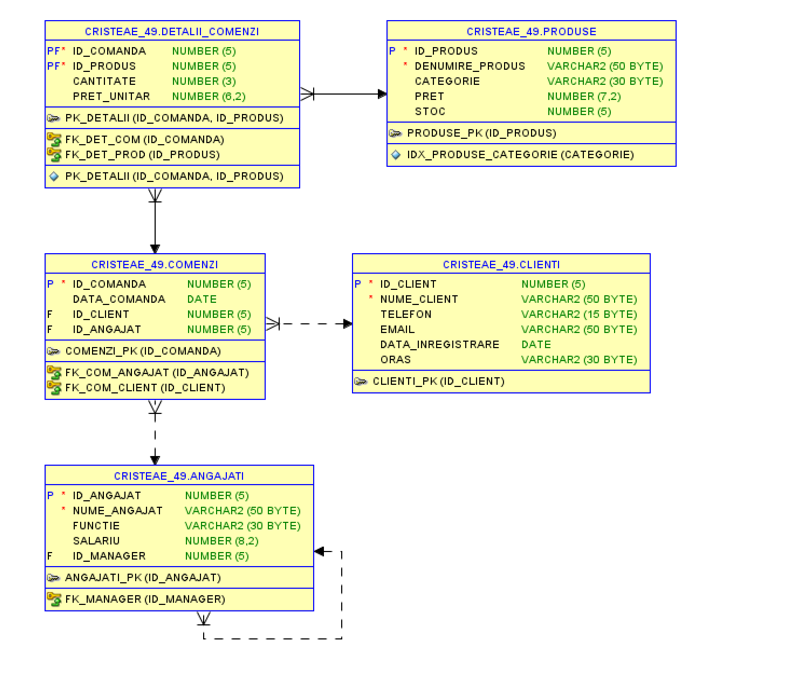

# CoffeeShop-Oracle-DB

A relational database that manages the day-to-day activity of a coffee shop, built with Oracle SQL and PL/SQL.

The project started as two assignments for the Databases and Database Management Systems courses at the Bucharest University of Economic Studies (ASE, CSIE) and was later refactored and extended. It covers the full lifecycle of a database: relational design, schema creation, sample data, SQL queries and a PL/SQL layer that automates and validates business operations.

## Key Functionality

- Store customers, employees, products, orders and order lines in a normalized (3NF) schema
- Model the staff hierarchy through a self-referencing manager relationship
- Analyze sales with SQL queries:
  - total value of each order and of each customer
  - best-selling product and top customer
  - average price per product category
- Process business rules in PL/SQL:
  - classify orders by value and products by price
  - flag products with critically low stock
  - apply loyalty discounts to orders older than 30 days
- Update stock automatically when a product is added to an order
- Reject invalid data such as non-positive prices or orders that exceed the available stock

## Built With

- Oracle Database (tested on [Oracle FreeSQL](https://freesql.com))
- SQL: DDL, DML, joins, aggregation, views, indexes, sequences, synonyms
- PL/SQL: cursors, exceptions, procedures, functions, packages, triggers
- Oracle Data Modeler for the relational diagram

## Database Schema



| Table | Contents |
|---|---|
| `CLIENTI` | Customers, with contact details, registration date and city |
| `ANGAJATI` | Employees, with salary and manager |
| `PRODUSE` | Products, with category, price and stock |
| `COMENZI` | Orders, each linked to a customer and an employee |
| `DETALII_COMENZI` | Order lines: product, quantity and unit price |

## Repository Layout

```text
.
├── sql/
│   ├── 01_schema.sql              # Drops existing objects and creates the tables
│   ├── 02_data.sql                # Sample data
│   ├── 03_queries.sql             # Filtering, aggregation and multi-table joins
│   └── 04_objects.sql             # View, index, sequence and synonym
├── plsql/
│   ├── 01_control_structures.sql  # IF / ELSIF / ELSE and loops
│   ├── 02_exceptions.sql          # User-defined and predefined exceptions
│   ├── 03_cursors.sql             # Explicit, parameterized and implicit cursors
│   ├── 04_procedures.sql          # Stored procedures
│   ├── 05_functions.sql           # Stored functions used in SQL queries
│   ├── 06_packages.sql            # pachet_clienti and pachet_produse
│   └── 07_triggers.sql            # Validation and automation triggers
├── docs/
│   ├── schema.png                 # Relational model
│   ├── Documentatie_BD.pdf        # Original database documentation (Romanian)
│   └── Documentatie_SGBD.pdf      # Original PL/SQL documentation (Romanian)
└── README.md
```

## Getting Started

1. Open an Oracle environment such as [Oracle FreeSQL](https://freesql.com) (free, runs in the browser) or Oracle SQL Developer.

2. Create the schema and load the sample data:

```text
sql/01_schema.sql
sql/02_data.sql
```

3. Run the remaining files in `sql/` and `plsql/` in numerical order, with `DBMS_OUTPUT` enabled:

```sql
set serveroutput on;
```

`01_schema.sql` removes any existing project objects first, so the setup can be re-run at any time. Sample dates are relative to `SYSDATE`, so date-based logic gives consistent results whenever the scripts are executed.

## Data Integrity Rules

Data is validated at database level, so invalid records are rejected regardless of how they are inserted:

- Every table has a primary key, and all relationships are enforced with foreign keys
- Names, product descriptions, order dates, quantities and unit prices are mandatory
- Prices and salaries must be positive, quantities must be greater than zero and stock can never be negative
- A trigger rejects non-positive prices with a clear error message
- A second trigger raises prices below 5 to a minimum value and is ordered with `FOLLOWS` so it always runs after validation
- A trigger blocks order lines that exceed the available stock and decreases the stock automatically otherwise
- Stock updates are transactional: if one product lacks stock, all changes are rolled back

## Improvements Over the Original Coursework

The documents in `docs/` reflect the original submission. The code was refactored afterwards to:

- make the setup re-runnable using dynamic SQL (`EXECUTE IMMEDIATE`)
- add stricter `NOT NULL`, `CHECK` and `DEFAULT` constraints
- replace identical `SYSDATE` values with realistic, relative dates
- fix the execution order of two `BEFORE INSERT` triggers
- make stock updates atomic with `ROLLBACK`
- keep processing the remaining orders when one order is invalid
- align price categories with the actual product prices

## Skills Demonstrated

- Designing and normalizing a relational database
- Enforcing data integrity through constraints and triggers
- Writing analytical SQL with joins, grouping and aggregation
- Structuring PL/SQL into reusable procedures, functions and packages
- Handling errors and controlling transactions
- Organizing database scripts so they can be run end to end